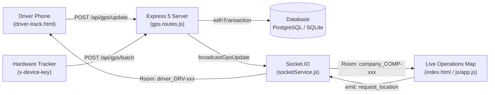

# LCOS Real-Time GPS Telemetry & Fleet Tracking Architecture

This document describes the end-to-end real-time GPS tracking system implemented for **LCOS (Logistics Operations Control System)**.

---

## 1. System Architecture & End-to-End Data Flow

The tracking pipeline bridges mobile phones, hardware GPS units, PostgreSQL/SQLite databases, and live browser dashboards:



1. **Ingest Phase:**
   - Single point updates sent to `POST /api/gps/update`.
   - Offline batch sync sent to `POST /api/gps/batch` (max 500 points per request, sorted chronologically, duplicates dropped).
2. **Authentication & Authorization:**
   - **Mobile Driver:** Authenticated via JWT bearer token. Vehicle and trip are resolved from the driver's active trip record (`/api/gps/my-trip`), preventing spoofing of arbitrary `vehicleId`s.
   - **Hardware Tracker:** Authenticated via SHA-256 hash comparison of `x-device-key` against `vehicles.device_key`.
3. **Database State Updates:**
   - Updates `vehicles` (current position, speed, heading, movement status, `last_gps_update`, `last_ping_at`).
   - Appends historical telemetry records to `gps_tracking_records`.
   - Stale batch guard ensures only the newest point updates live vehicle status, while all points enter history.
4. **Real-time Broadcast:**
   - Broadcasts `gps_update` scoped strictly to the tenant's company room (`company_${companyId}`).
5. **Live Map Dashboard:**
   - Leaflet marker registry tracks vehicle markers without whole-map redraws.
   - 1.5s smooth `requestAnimationFrame` ease-in-out interpolation.
   - Heading-based rotation applied to inner marker element (`.truck-marker-inner`).
   - Auto-extending historical polyline on incoming pings.
   - 30s background staleness evaluator marks pings $> 5$ minutes old as Stale.

---

## 2. Ingest API Endpoints

### `POST /api/gps/update`
Receives a single real-time GPS telemetry point.
- **Headers:** `Authorization: Bearer <driverJwt>` OR `x-device-key: <deviceKey>`
- **Payload:**
```json
{
  "vehicleId": "TN-01-AB-1234",
  "lat": 13.0827,
  "lng": 80.2707,
  "speedKmh": 45,
  "heading": 90,
  "accuracy": 12,
  "recordedAt": "2026-08-04T08:30:00.000Z"
}
```

### `POST /api/gps/batch`
Ingests up to 500 offline/historical points buffered during network loss.
- **Headers:** `Authorization: Bearer <driverJwt>` OR `x-device-key: <deviceKey>`
- **Payload:**
```json
{
  "vehicleId": "TN-01-AB-1234",
  "points": [
    { "lat": 13.0820, "lng": 80.2700, "speedKmh": 40, "heading": 90, "accuracy": 10, "recordedAt": "2026-08-04T08:29:00.000Z" },
    { "lat": 13.0827, "lng": 80.2707, "speedKmh": 45, "heading": 90, "accuracy": 12, "recordedAt": "2026-08-04T08:30:00.000Z" }
  ]
}
```

### `GET /api/gps/my-trip`
Returns the active in-transit trip and vehicle registration for the logged-in driver.
- **Headers:** `Authorization: Bearer <driverJwt>`

### `POST /api/vehicles/:id/device-key`
Admin endpoint to generate or rotate a vehicle's hardware tracker device key.
- **Headers:** `Authorization: Bearer <adminJwt>` (`SUPER_ADMIN` or `OWNER` role)
- **Response:** Returns plaintext key once. Stored in DB as SHA-256 hash.

---

## 3. Mobile Driver Interface (`driver-track.html`)

- **Screen Wake Lock API:** Prevents phone display from sleeping while tracking is active.
- **IndexedDB Offline Queue:** Buffers up to 5,000 GPS fixes locally when internet connectivity drops. Automatically flushes in chunks of $\le 500$ when back online.
- **Clock Skew Auto-Calibration:** Automatically detects client/server clock offset if the server returns a 400 future timestamp error and resends with adjusted timestamp.
- **Rate Limit Backoff:** Handles HTTP 429 responses with exponential backoff without dropping fixes.
- **Background Visibility Warning:** Displays warning banner if user leaves browser tab in background.
- **Dispatcher Location Request:** Listens on private Socket room `driver_<driverId>` and immediately answers incoming `request_location` pings from dispatchers.

---

## 4. Live Dashboard Map (`js/app.js` & `index.html`)

- **Persistent Marker Registry:** `Map<vehicleId, entry>` ensures markers are reused across updates without DOM node recreation.
- **Rotation Isolation:** Leaflet's outer translation transform is untouched; rotation angle is applied purely to `.truck-marker-inner`.
- **Dynamic Popup Telemetry:** Popups reflect vehicle speed, driver identity, cargo, route, and live connection age.
- **"Ping Driver Now" Button:** Emits `request_location` over Socket.IO with interactive 15-second countdown and delivery ack feedback.
- **History Polyline Extension:** Selecting a vehicle fetches historical points up to 500 and dynamically appends newly received fixes.
- **Closed Trip Cleanup:** Automatically cleans up markers, polyline layers, and registry entries when a trip is concluded.

---

## 5. Verification & Test Suite

All test suites run in isolation against temporary databases without modifying production data.

| Command | Engine / Environment | Description | Pass Count |
| :--- | :--- | :--- | :--- |
| `npm test` | SQLite | Unit and API ingestion tests (rate limiting, auth, stale batch guard) | **19/19** |
| `npm run test:pg` | PostgreSQL (Port 5434) | Live PostgreSQL transaction, constraint, and migration verification | **17/17** |
| `npm run test:driver` | Headless Playwright | Mobile driver tracker tests (IndexedDB, wake lock, clock skew, batch flush) | **13/13** |
| `npm run test:map` | SQLite & PostgreSQL | Multi-session live Leaflet dashboard E2E tests (15 verification phases) | **15/15** |
| `npm run tunnel:test` | Isolated SQLite | Starts server with temporary DB copy and warning for ngrok/cloudflared testing | -- |

---

## 6. Real-Time GPS Simulator (`scripts/gps_simulator.js`)

Simulates realistic vehicular movement along road corridors in Tamil Nadu.

### Usage:
```bash
# Basic simulation between Chennai and Madurai at 60 km/h:
npm run sim

# Custom parameters:
npm run sim -- --vehicle=TN-01-AB-1234 --from=BR-CHE --to=BR-MDU --speed=65 --interval=5

# Simulating a scheduled stop (halt at 50% of the route for 60 seconds):
npm run sim -- --from=BR-CHE --to=BR-TRY --stop-at=0.5 --stop-secs=60

# Simulating cellular dead-zone / mountain tunnel (drops signal, queues points, flushes batch):
npm run sim -- --from=BR-CHE --to=BR-CBE --drop-signal-secs=30

# Using hardware device key authentication:
npm run sim -- --vehicle=TN-01-AB-1234 --device-key=raw_device_key_here
```

### CLI Options:
- `--vehicle`: Vehicle registration number (default: `TN-01-AB-1234`).
- `--from`: Origin branch code or `lat,lng` (default: `BR-CHE`).
- `--to`: Destination branch code or `lat,lng` (default: `BR-MDU`).
- `--speed`: Speed in km/h (default: `60`).
- `--interval`: Ingestion interval in seconds (default: `5`, minimum: `3`).
- `--base-url`: Target server URL (default: `http://localhost:5000`). Refuses non-localhost unless `--allow-remote` is passed.
- `--device-key`: Hardware device key for authentication.
- `--username` / `--password`: Driver credentials if testing mobile driver auth.
- `--stop-at`: Journey fraction ($0.0 \dots 1.0$) to halt.
- `--stop-secs`: Duration of stoppage in seconds.
- `--drop-signal-secs`: Duration of simulated cellular drop.
- `--jitter`: GPS noise jitter in meters (default: `5`).
